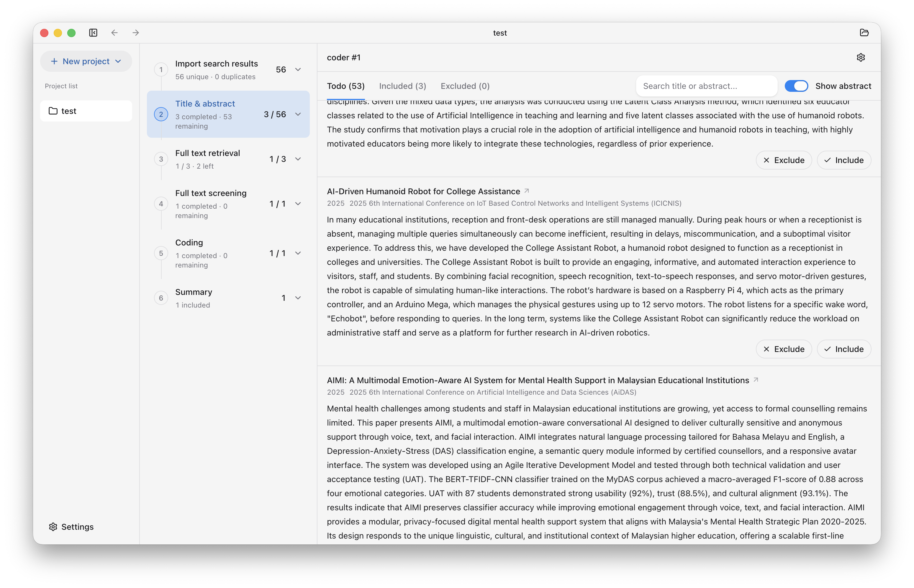

# Panorama Review

Panorama Review 是一款用于文献综述项目的桌面应用，帮助研究者整理、筛选和审阅学术论文。

[English](README.md) · 简体中文

Panorama Review 目前可免费用于教育和研究用途。

## 概述

Panorama Review 帮助研究团队管理文献综述流程，涵盖文献筛选、编码和冲突解决。

## 下载

前往 [GitHub Releases](https://github.com/panorama-lab/review/releases) 下载最新版本。

## 功能

### PRISMA 工作流程支持

- 创建文献筛选会话
- 创建编码会话
- 解决筛选与编码冲突

### 通过 LibKey 获取全文

- 配置 LibKey 全文解析服务地址。
- 在“获取全文”阶段，点击“下载”获取 PDF。
- 下载的 PDF 会自动关联到对应的文献记录。

## 社区

- [报告问题或提出功能建议](https://github.com/panorama-lab/review/issues)
- [加入 Discord 社区](https://discord.gg/PtgNPuHMFs)
